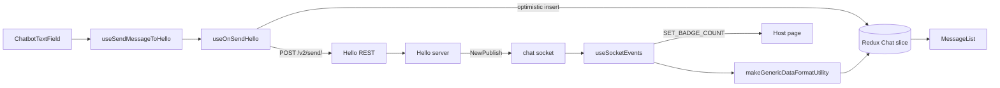

# Architecture

The MSG91 Hello web chat widget. A plain-JS embed script (`public/chat-widget.js`) runs on the customer's site, draws the launcher and opens an iframe that loads this Next.js 15 / React 19 app. Inside the iframe the app talks to the MSG91 Hello backend over HTTP (`config/helloApi.ts`) and two socket.io connections, and keeps its state in a Redux store persisted to browser storage. There is no server-side logic of our own: both pages are client components rendered on the Cloudflare edge runtime.

## Entry point and startup

Two programs run, one in each window:

| Program | Runs in | Entry | Doc |
|---|---|---|---|
| Embed script | Customer's page | `public/chat-widget.js` (plus `-dev` / `-local` copies) | [embed-script](modules/embed-script.md) |
| Widget app | Iframe | `app/chatbot/page.tsx` → `app/chatbot/[chatbotId]/page.tsx` | [app-shell](modules/app-shell.md) |

Startup in short (full trace with branches: [flows/widget-boot](flows/widget-boot.md)):

1. The host page loads the script; `HelloChatbotEmbedManager` builds a hidden launcher and a hidden iframe pointing at `<scriptOrigin>/chatbot`.
2. `app/chatbot/page.tsx` stores a per-tab `tab_session_id` and redirects to `/chatbot/hello`, which renders `ChatbotWrapper` inside the providers from `components/AppWrapper.tsx` (Redux `Provider`, `PersistGate`, MUI theme).
3. `components/Chatbot-Wrapper/ChatbotWrapper.tsx` registers the postMessage handlers and posts `interfaceLoaded` to the host.
4. Once the host has called `initChatWidget` and its delay has elapsed, the script posts `helloData`. `handleHelloData` in `hooks/HELLO/eventHandlers/embeddingScript/embeddingScriptEventHandler.ts` sets `chatSessionId`; only then does `components/Chatbot/Chatbot.tsx` mount.
5. `components/Chatbot/hooks/useHelloEffects.ts:useHelloEffects` runs the Hello init sequence: routing region → widget info → identity → channels → socket JWT. The sockets connect when the JWT lands in Redux.

> [!WARNING]
> `app/page.tsx` and the "Create Next App" metadata in `app/layout.tsx` are untouched create-next-app boilerplate. The widget only lives under `/chatbot`.

## Layers

| Layer | Folder | Owns | May call |
|---|---|---|---|
| Embed script | `public/` | Launcher, iframe, host-page API, host-side push popups, co-browse bootstrap | The iframe, via postMessage only |
| Routes and providers | `app/`, `components/AppWrapper.tsx`, `components/Chatbot-Wrapper/` | Tab session id, store and theme providers, postMessage bridge mount | Event handlers, `Chatbot` |
| Event bridge | `hooks/CORE/`, `hooks/HELLO/`, `utils/emitEventsToParent/` | Translating host events into Redux and Hello calls; emitting events back to the host | Store, `config/helloApi.ts` |
| Container and hooks | `components/Chatbot/` | Init sequence, send path, socket wiring, voice service | `config/`, `hooks/`, store |
| Hello client | `config/` | Every REST call, region routing | axios instance in `utils/helloInterceptor.ts` |
| Realtime | `hooks/socket*.{js,ts}`, `hooks/notifications/`, `hooks/coBrowser/` | socket.io connections, channel subscriptions | Store |
| State | `store/`, `types/` | Redux slices, persistence, cross-tab sync | `utils/emitEventsToParent/` (one reducer side effect) |
| UI | `components/Interface-Chatbot/`, `components/Hello/`, `components/FormComponent.tsx` | Rendering, user input | Container hooks, store |

UI components do not call `config/helloApi.ts` for sending; they go through the hooks in `components/Chatbot/hooks/`. Exceptions exist (`components/FormComponent.tsx` calls `saveClientDetails`, the CSAT card calls `submitFeedback`), so check the module doc before assuming.

## How a message moves

1. Sending is HTTP only: the composer, interactive buttons and starter questions call `components/Chatbot/hooks/useHelloIntegration.ts:useSendMessageToHello`, which calls `useOnSendHello` to post to Hello; call buttons call `useOnSendHello` directly because they need the response. The chat socket never carries outgoing messages; the client only emits `subscribe`, `unsubscribe`, `typing` and `not-typing` on it. See [flows/send-message](flows/send-message.md).
2. Receiving is socket only: `hooks/socketEventHandler.ts:useSocketEvents` handles `NewPublish` and `Typing`. See [flows/receive-message](flows/receive-message.md) and [realtime](modules/realtime.md).
3. Raw Hello messages (history and socket) are normalized by `utils/dataConvertWrappers/makeGenericDataFormatUtility.tsx` before they reach Redux. See [message-rendering](modules/message-rendering.md).
4. History is fetched over HTTP when a channel is opened and after a socket reconnect.

## External systems

| System | Used for | Client code | Doc |
|---|---|---|---|
| MSG91 Hello REST | Widget info, identity, channels, history, send, upload, feedback, WebRTC tokens | `config/helloApi.ts` | [hello-api](integrations/hello-api.md) |
| Hello region router | Picks the per-company API and socket hosts | `config/regionConfig.ts`, `getRoutingRegion` in `config/helloApi.ts` | [hello-api](integrations/hello-api.md) |
| Hello chat socket | Incoming messages, typing | `hooks/socketManager.js` | [realtime](modules/realtime.md) |
| Hello notification socket | Campaign / push notifications | `hooks/notifications/notificationSocketManager.ts` | [realtime](modules/realtime.md) |
| msg91-webrtc-call | Voice calls | `components/Chatbot/hooks/HelloVoiceService.ts` | [voice-calling](modules/voice-calling.md) |
| Cobrowse.io | Screen sharing with an agent | `hooks/coBrowser/CBManger.ts` + embed script | [embed-script](modules/embed-script.md) |
| Middleware experiments endpoint | A/B event beacons (not yet called) | `utils/middlewareExperiments.ts` | [app-shell](modules/app-shell.md) |
| microlink.io | Link preview cards, fetched from the visitor's browser | `components/Interface-Chatbot/Messages/` | [message-rendering](modules/message-rendering.md) |

Configuration for these lives in [environment](environment.md).

## Cross-repo contracts

> [!WARNING]
> The host-page contract is public: customers have `window.initChatWidget(...)` and `window.chatWidget.*` calls in their own sites. Renaming a method, an `initChatWidget` key or a postMessage type breaks live installs. The full surface is in [api](api.md).

> [!WARNING]
> The three embed scripts (`public/chat-widget.js`, `public/chat-widget-dev.js`, `public/chat-widget-local.js`) are hand-maintained copies with no build step. A change to one must be made to all three, keeping only their intended differences ([embed-script](modules/embed-script.md)).
