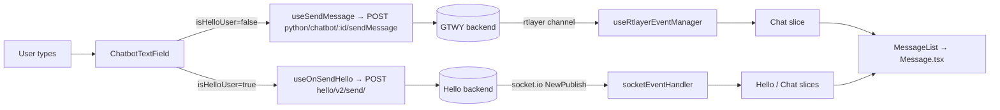

# Architecture

chat-widget is the frontend of an embeddable chat widget. A customer pastes a plain-JS loader script from `public/` into their site. The script draws a launcher and opens an iframe that points at this Next.js 15 app (App Router, React 19, Redux Toolkit + redux-saga, MUI + Tailwind). The app is deployed on Cloudflare Pages.

One component set serves two products with two different backends, both in other repos:
- **GTWY**: an AI bot ("interface" / "bridge"). It uses the GTWY Node and Python APIs, and replies arrive over rtlayer.
- **MSG91 Hello**: human agents, tickets, bots and calls. It uses the Hello REST API and socket.io.

The repo stores no business state of its own; the backends are the source of truth.

## Entry point and startup

1. **Host page:**
   - `public/chat-widget.js` (Hello) or `public/chatbot.js` (GTWY) creates the launcher and an iframe at `<origin>/chatbot?interfaceDetails=<json>`.
   - Each script has `-dev` and `-local` copies.
   - The host-side API and postMessage protocol are in [api.md](api.md); the mechanism is in [modules/embed-scripts.md](modules/embed-scripts.md).
2. **`app/layout.tsx`:** renders `components/AppWrapper.tsx`. That sets up Redux, `PersistGate`, the MUI theme and `ThemeContext`.
3. **The Redux store:**
   - `store/index.js` builds it from `store/combineReducer.js`. The slices are `Interface`, `Hello`, `Chat`, `draftData` and `appInfo`.
   - It wires in redux-persist, redux-state-sync (cross-tab) and the saga from `store/rootSaga.ts`.
   - It also wires in `customMiddleware`, which stamps `action.urlData` (`chatSessionId`, `tabSessionId`) on every action so reducers know which widget and tab they're writing for.
4. **`app/chatbot/layout.tsx` and `app/chatbot/page.tsx`** (edge runtime): parse `interfaceDetails` and `?env=stage`, then redirect to `/chatbot/<chatbot_id>` for GTWY or `/chatbot/hello` for Hello.
5. **`components/Chatbot-Wrapper/ChatbotWrapper.tsx`:** posts `interfaceLoaded` to the host. The host answers with:
   - `helloData` (Hello), handled in `hooks/HELLO/eventHandlers/embeddingScript/embeddingScriptEventHandler.ts`, or
   - `interfaceData` (GTWY), handled in `hooks/GTWY/eventHandlers/embeddingScript/embeddingScriptEventHandler.ts`.
6. **Per-product boot:**
   - **Hello:** resolve the routing region, then widget-info, then client registration, then the socket JWT, greeting and teams. See [integrations/hello.md](integrations/hello.md).
   - **GTWY:** the token goes into sessionStorage `interfaceToken`, then threads and history load.

   The full trace is in [flows/widget-boot.md](flows/widget-boot.md).

## Layers

| Layer | Folder | Owns | May call | Must not |
|---|---|---|---|---|
| Host loader scripts | `public/` | Launcher, iframe, `window.chatWidget` / `window.Chatbot` / RAG globals, postMessage to the iframe | Its own backend for GTWY login | Rely on a build step; each env copy is hand-edited |
| Embedding handlers | `hooks/CORE/`, `hooks/HELLO/`, `hooks/GTWY/` | Turn host postMessages into Redux state | Store actions, `config/*` | Contain UI |
| UI | `components/`, `app/` | Rendering, local UI state, React Contexts | Hooks in `components/Chatbot/hooks/`, store selectors | Call axios directly, except in a few legacy spots |
| Chat hooks | `components/Chatbot/hooks/` | Send, receive and boot logic per product | `config/*`, socket managers, store | |
| API clients | `config/api.ts` (GTWY), `config/helloApi.ts` (Hello), `config/ragApi.ts` | One function per endpoint | axios through `utils/interceptor.ts` / `utils/helloInterceptor.ts` | Hold state |
| Realtime | `hooks/socketManager.js` (Hello socket.io), `hooks/notifications/` (notification socket.io), `components/Chatbot/hooks/useRtlayerEventManager.tsx` (GTWY rtlayer) | One connection per backend | Store actions | Make routing decisions; the backend decides |
| State | `store/` | Per-widget and per-tab UI state; some of it persisted | | Act as the source of truth for conversations |

## How a message moves

1. `components/Interface-Chatbot/ChatbotTextField.tsx` picks the path from `state.draftData.isHelloUser`.
2. **GTWY:** `components/Chatbot/hooks/useChatActions.ts:useSendMessage` adds optimistic messages, then POSTs. The HTTP response body is ignored. The answer arrives on an rtlayer channel built from `chatSessionId + threadId + subThreadId`. The UI gives up after 240 s. See [flows/ai-message.md](flows/ai-message.md).
3. **Hello:** `components/Chatbot/hooks/useHelloIntegration.ts:useOnSendHello` subscribes to the new channel *before* sending (the first bot reply was being lost), then POSTs `/v2/send/`. Agent and bot messages arrive as socket.io `NewPublish` events. See [flows/hello-human-chat.md](flows/hello-human-chat.md).
4. `components/Interface-Chatbot/Messages/Message.tsx` renders by `role`. An AI reply that parses to `{components: [...]}` renders as JSON UI ([modules/interface-renderer.md](modules/interface-renderer.md)).

## External systems

| System | Used for | Client code | Doc |
|---|---|---|---|
| GTWY Node API (`NEXT_PUBLIC_API_BASE_URL`) | History, threads, bridge config, RAG docs | `config/api.ts`, `config/ragApi.ts` | [flows/ai-message.md](flows/ai-message.md) |
| GTWY Python API (`NEXT_PUBLIC_PYTHON_API_BASE_URL`) | Sending AI messages | `config/api.ts` | [flows/ai-message.md](flows/ai-message.md) |
| rtlayer (`rtlayer-client`) | AI replies in real time | `components/Chatbot/hooks/useRtlayerEventManager.tsx` | [flows/ai-message.md](flows/ai-message.md) |
| MSG91 Hello REST (region host) | Clients, channels, send, feedback, calls | `config/helloApi.ts`, `config/regionConfig.ts` | [integrations/hello.md](integrations/hello.md) |
| Hello socket.io (region host) | Inbound chat events, typing | `hooks/socketManager.js` | [integrations/hello.md](integrations/hello.md) |
| Notification socket.io + FCM | Push and launcher notifications | `hooks/notifications/` | – |
| msg91-webrtc-call | Voice calls | `components/Chatbot/hooks/HelloVoiceService.ts` | [integrations/hello.md](integrations/hello.md) |
| cobrowse.io | Co-browsing | `hooks/coBrowser/CBManger.ts`, `public/chat-widget.js` | – |
| Cloudflare Pages | Hosting (`@cloudflare/next-on-pages`) | `package.json` `build:pages` | [environment.md](environment.md) |

## Environments

Endpoints come from three places:
- build-time `NEXT_PUBLIC_*` variables
- a runtime `?env=stage` iframe URL parameter, which swaps in hard-coded stage hosts
- the Hello routing-region response, which overrides the Hello host and socket URLs in memory only

Each loader script exists as `-local`, `-dev` and prod copies that are edited by hand and have drifted apart. See [environment.md](environment.md).

## Cross-repo contracts

> [!WARNING]
> Customer sites call the loader scripts' globals and postMessage types. Never rename or remove these:
> - `window.chatWidget`, `window.initChatWidget`, `window.Chatbot`, `window.openRag`
> - the `ParentEventType` values in `utils/emitEventsToParent/emitEventsToParent.tsx`
> - the script URLs
>
> The full contract is in [api.md](api.md).

> [!WARNING]
> The rtlayer channel string (built in `components/Chatbot/hooks/useRtlayerEventManager.tsx`) and the Hello channel id format (`ch-comp-<companyId>...`) must match what the backends publish to. A mismatch fails silently: the AI path shows a timeout after 240 s, and the Hello path shows no reply.

## Decisions and history

- **Iframe plus postMessage**, so the widget's React/MUI styles and state can't clash with the host page. The host script stays plain JS with no build step. That is why three per-environment copies exist.
- **The region is resolved at runtime, not persisted.** Hello companies are pinned to a region, so every call must go to that region's host. The requirements are in `docs/brainstorms/region-wise-routing-requirements.md`.
- **Chat state moved from a local React reducer to Redux** (commit 2da4094). The old `components/Chatbot/hooks/chatReducer.ts` is dead code.
- **The build ignores TypeScript and ESLint errors** (`next.config.ts`). Run `npx tsc --noEmit` and `npm run lint` yourself.
  > [!TODO] Needs a human: why are type-check and lint disabled in `next build`?
