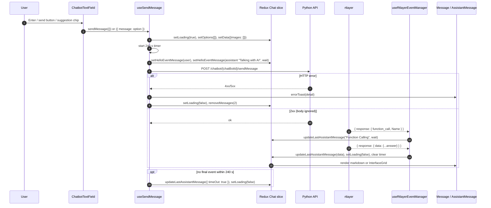

# Flow: AI message (GTWY mode)

A user sends text (and optional uploaded images/PDFs) to a GTWY AI agent. The widget adds two optimistic messages, POSTs to the Python GTWY API, and gets the answer back asynchronously over **rtlayer**, replacing the "Talking with AI" placeholder in place. The answer renders as markdown or, for JSON with `components`, as MUI widgets.

Applies only when `draftData.isHelloUser` is false. Hello mode goes through `useSendMessageToHello` instead ([hello](../integrations/hello.md#sending-a-message)). Module details: [chat-ui](../modules/chat-ui.md) (rendering), [interface-renderer](../modules/interface-renderer.md) (JSON UI). Endpoint list: [api](../api.md).

## Sequence



## Steps

1. **Input** — `components/Interface-Chatbot/ChatbotTextField.tsx:handleSendMessage`.
   Enter (without Shift) or the send button, only when `buttonDisabled` is false: GTWY disables while `Chat.loading`, while uploading, when text and images are both empty, or when a PDF is attached without text. Clears its local `inputValue`, clears `prefillInputMessage`, calls `sendMessage(messageObj)`, then `clearReply()` (a reply preview is discarded in GTWY mode). Suggestion chips call `handleSendMessage({ message: option })`.
   Other entry points into the same hook: host `askAi` / `SendDataToChatbot({ askAi })` (`components/Chatbot/hooks/useChatEffects.ts`, rejected with a toast while `loading`), JSON-UI buttons with `action.actionType === "reply"` (`utils/ChatbotUtility.ts:perFormAction` from `components/Interface-Button/InterfaceButton.tsx`), and starter questions.
2. **Attachments (before send)** — `ChatbotTextField.tsx` upload handler → `config/api.ts:uploadImage` (`POST {PYTHON_URL}/image/processing/`, form field `image`) → on `success` the returned `image_url` is appended to `Chat.images`. Errors: toast, the file is dropped.
3. **Build and dispatch** — `components/Chatbot/hooks/useChatActions.ts:useSendMessage`.
   - `textMessage = message || messageRef.current.value`. Splits `Chat.images` by extension: `.pdf` → `files`, the rest → `images`. Returns if there is no text and no image.
   - Clears the input ref, `setLoading(true)`, `setOptions([])`, starts the 240 000 ms timer in `timeoutIdRef`, `setData({ options: [], images: [] })`.
   - Optimistic pair, newest first in `Chat.messageIds[Chat.subThreadId]`:
     ```ts
     setHelloEventMessage({ message: { role: "user", content: textMessage, urls: images /* all, incl. pdf */ } })
     setHelloEventMessage({ message: { role: "assistant", content: "Talking with AI", wait: true } })
     ```
     `store/chat/chatReducerV2.ts:setHelloEventMessage` runs `convertEventMessageToGenericFormat(message, false)`, which gives each a generated `id` (`Id` if present, else `generateNewId()`), and also prepends the raw message to `rawHelloMsgList`.
4. **HTTP** — `config/api.ts:sendDataToAction` → `POST {NEXT_PUBLIC_PYTHON_API_BASE_URL}/chatbot/{chatBotId}/sendMessage`. `utils/interceptor.ts` adds `Authorization: sessionStorage.interfaceToken`.
   ```ts
   {
     message: string, images: string[], files: string[],
     userId: string | null,                               // appInfo.userId
     interfaceContextData: { ...Interface[chatSessionId].interfaceContext[bridgeName].variables, ...customVariables },
     threadId: string,                                    // customThreadId || appInfo.threadId; "" if falsy (set in sendDataToAction)
     subThreadId: string,                                 // appInfo.subThreadId
     slugName: string,                                    // customBridgeSlug || appInfo.bridgeName
     thread_flag: boolean,                                // true for a new chat, or the single default sub-thread (sub_thread_id === thread_id === display_name)
     chatBotId: string,                                   // draftData.chatSessionId (= chatbot_id)
     version_id: string | null,                           // appInfo.versionId; "null" → null
     configuration?: { model }, service?: string          // only when Interface.selectedAiServiceAndModal has both
   }
   ```
   Returns `{ success: true, data: response.data.data }` or `{ success: false }`. The success body is not used.
5. **Failure path** — on `!response.success`: `setLoading(false)`, `removeMessages({ numberOfMessages: 2 })` (drops the first two ids of `Chat.subThreadId`). The toast was already shown by `sendDataToAction`: `error.response.data.detail.error`, else `detail`, else "Something went wrong!". A 5xx also shows "Server Error, Try again later" (interceptor); a 401 clears localStorage and redirects the iframe ([app-shell](../modules/app-shell.md#gotchas)).
6. **Listen** — `components/Chatbot/hooks/useRtlayerEventManager.tsx`. The client (`useWebSocketClient`) exists only when `ChatbotContext.isHelloUser` is false. One listener on
   ```ts
   (chatSessionId + (threadId || userId) + (subThreadId || userId)).replace(/ /g, "_")
   ```
   re-attached when any of those change; the effect cleanup also clears the timer. The backend must publish to the same string.
7. **Handle events** — `handleMessageRTLayer(message: string)` → `JSON.parse`, then the first matching case:

   | Event (parsed) | Dispatch | Ends wait? |
   |---|---|---|
   | `{ status: "connected" }` | none | no |
   | `{ response: { function_call: truthy, Name?: string[] } }` (no `message`) | `updateLastAssistantMessage({ role: "assistant", wait: true, content: "Function Calling", Name, id: generateNewId() })` | no |
   | `{ response: { function_call, message, Name? } }` | same, `content: message` | no |
   | `{ error: string }` with no `response.data` | `updateLastAssistantMessage({ role: "assistant", content: error, id })`, `setLoading(false)` | yes |
   | `response.data.role === "reset"` and no `mode` | `setHelloEventMessage({ role: "reset", content: "Resetting the chat" })` (adds, does not replace) | no |
   | `response.data.suggestions` defined | `setOptions(suggestions)` (chips above the input) | no |
   | `response.data.display_name` | `setThreads({ newThreadData: data, bridgeName, threadId: data.thread_id })` — names the new chat; the `appInfo` extra-reducer sets `subThreadId = data.sub_thread_id` | no |
   | any other `response.data` | `updateLastAssistantMessage({ role: data.role \|\| "assistant", ...data })`, `setLoading(false)` | yes |

   `updateLastAssistantMessage` (`store/chat/chatReducerV2.ts`) replaces index 0 of `messageIds[state.subThreadId]` with `payload.id` and stores the payload as-is under that id. It does not normalize and does not check that index 0 is the placeholder.
8. **Render** — `components/Interface-Chatbot/Messages/Message.tsx` switches on `role`; `assistant` → `components/Interface-Chatbot/Messages/AssistantMessage.tsx:AssistantMessageCard`:
   - `wait: true` → `Name[]` (tool names) + `content` + loading bars. This is the "Talking with AI" / "Function Calling" state.
   - `timeOut: true` → "Timeout reached. Please try again later."
   - `image_urls[]` → images.
   - else, if `chatbot_message || content` is a JSON string with `isMarkdown` or `response` → markdown of `markdown` or `JSON.stringify(response)`; with `components` (and neither of those) → `InterfaceGrid` (`components/Grid/Grid.tsx`) with `componentJson = parsed`, `gridId = responseId || "default"`, `msgId = createdAt` ([interface-renderer](../modules/interface-renderer.md)).
   - else plain markdown; `tools_data` keys shown as "N Functions executed"; thumbs up/down when `message_id` exists (`useMessageFeedback`).
9. **Timeout** — if no ending event arrives, after 240 s the timer dispatches `updateLastAssistantMessage({ role: "assistant", wait: false, timeOut: true })` and `setLoading(false)`.

## Data at key hops

```ts
// rtlayer final answer (keys this repo reads; produced by the GTWY backend)
{ response: { data: {
    role: "assistant", content?: string, chatbot_message?: string,   // text, or a JSON string
    Id?: string, id?: string, message_id?: string,                    // message_id enables feedback
    tools_data?: object, image_urls?: { image_url?, permanent_url? }[],
    createdAt?, created_at?, error?, suggestions?: string[], display_name?, thread_id?, sub_thread_id?
} } }

// JSON content that renders as UI (string inside content/chatbot_message)
{ "components": [ { "type": "button", "props": { "label": "Yes" }, "action": { "actionType": "reply" } } ],
  "variables": { }, "responseId": "…" }

// Chat slice after the final answer (sub-thread "S")
messageIds.S = ["<answer id>", "<user msg id>", ...older]
msgIdAndDataMap.S["<answer id>"] = { role: "assistant", ...data }
loading = false
```

## Errors

| Where | What happens | User sees |
|---|---|---|
| Upload | `uploadImage` returns `null` → the `response.success` read throws, caught by the upload handler | toast, file not attached |
| `sendMessage` POST | `sendDataToAction` catch → `{ success: false }` → `removeMessages(2)` | toast with backend `detail` |
| 401 on any GTWY call | `localStorage.clear()`, iframe navigates to `/?error=session expired` | blank Next page |
| rtlayer `{ error }` | placeholder replaced by the error text | error text as the answer |
| No answer | 240 s timer | "Timeout reached…" card |
| Malformed rtlayer payload | `JSON.parse` throws inside the listener (uncaught); unmatched shapes hit `default:` → `console.warn` | placeholder stays until timeout |

## Side effects

- HTTP: `POST {PYTHON_URL}/image/processing/` (upload), `POST {PYTHON_URL}/chatbot/{chatBotId}/sendMessage`.
- rtlayer subscription on the channel above (one per mounted `Chatbot`).
- Redux `Chat` (not persisted, not cross-tab synced, except `notifications`); `Interface` thread list and `appInfo.subThreadId` on `display_name`.
- postMessage to the host only from JSON-UI actions: `FRONT_END_ACTION` (`actionType: "sendDataToFrontEnd"`).
- No storage writes on the send path.

## Gotchas

> [!WARNING]
> The failure path does not clear the 240 s timer. After a failed send (toast, optimistic pair removed), the timer still fires and replaces whatever is now index 0 of the current sub-thread (an older real message) with the timeout card. Sending again also overwrites `timeoutIdRef.current` without clearing the previous timer, so an earlier timer can fire mid-answer. Clear `timeoutIdRef.current` on every exit path if you touch this hook.

> [!WARNING]
> `updateLastAssistantMessage` and `removeMessages` act on `state.Chat.subThreadId`, not on the sub-thread the message was sent from. If the user switches chats while the POST is in flight and it fails, `removeMessages(2)` deletes the two newest messages of the chat now on screen. A switch also re-attaches the rtlayer listener to the new channel (and clears the timer), so the answer for the old chat is dropped. `components/Interface-Chatbot/ChatbotDrawer.tsx:handleChangeSubThread` calls `setLoading(false)` so the input is usable again; any other code that changes `subThreadId` must do the same.

> [!WARNING]
> The final-answer branch stores the backend `data` as-is under `payload.id`. If the backend sends only `Id` (capital) and no `id`, the map key is `"undefined"` and the next final answer overwrites it. Same for the timeout payload, which has no `id`.

> [!WARNING]
> Add new rtlayer event kinds **above** the catch-all `!!data` case in `handleMessageRTLayer`; anything reaching it is treated as the final answer and ends the wait.

> [!WARNING]
> The rtlayer listener is created from `ChatbotContext.isHelloUser`, while the text field picks the send path from `state.draftData.isHelloUser`. They must agree, or a GTWY send has no listener (answer only via timeout).

## Changing it safely

- New payload field: add it in `useSendMessage` and confirm the Python backend accepts it; host-provided data belongs in `interfaceContextData` (variables) rather than a new top-level key.
- New UI for a reply type: branch in `AssistantMessageCard` before the markdown fallback; keep `wait`/`timeOut` checks first.
- Check in devtools: one `sendMessage` POST, the placeholder, an optional "Function Calling" step, then the answer; then repeat with the network offline to see the toast and the optimistic pair removed.
