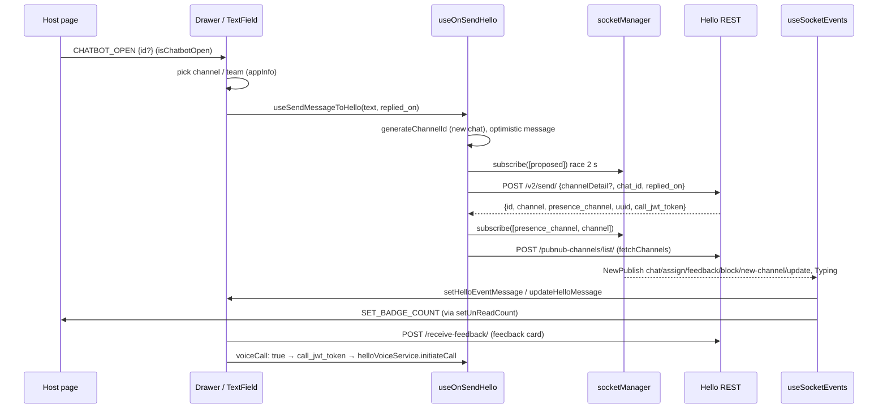

# Flow: Hello human chat

An end user opens a booted Hello widget, picks or starts a conversation (channel), sends messages over `POST /v2/send/`, and gets agent/bot replies, assignment changes, feedback cards and voice calls over socket.io. It starts where [widget-boot](widget-boot.md) ends: `Hello[chatSessionId]` holds `widgetInfo`, `channelListData` and `socketJwt`, the client id is in localStorage, and the socket is connected. Identity, endpoint list and event table: [hello](../integrations/hello.md). Components: [chat-ui](../modules/chat-ui.md). Endpoint tables: [api](../api.md).



## Steps

1. **Host opens the widget** — `hooks/HELLO/eventHandlers/embeddingScript/embeddingScriptEventHandler.ts:handleChatbotVisibility`
   `CHATBOT_OPEN` sets `appInfo.isChatbotOpen = true` and `draftData.isChatbotMinimized = false`. With a non-empty `id` it calls `handleShowTicket`, which looks the id up in `channelListData.channels` and sets `subThreadId` / `currentChannelId` / `currentChatId` plus `overrideChannelId: id`, and closes the drawer. An unknown id leaves the channel fields empty but keeps `overrideChannelId`, so the next send targets that id. `CHATBOT_CLOSE` sets `isChatbotOpen = false`, which stops unread resets (step 11).

2. **Drawer shows channels and teams** — `components/Interface-Chatbot/ChatbotDrawer.tsx`
   Reads `Hello[chatSessionId].channelListData.channels` (from boot's `getAllChannels`, `POST /pubnub-channels/list/`, sorted closed-last by `setChannelListData`) and `widgetInfo.teams`. Whether the drawer starts open, and the default jump into chat for ≤1 team / ≤1 channel (`isDefaultNavigateToChatScreen`), is in [chat-ui](../modules/chat-ui.md#gotchas).
   - Channel click → `handleChangeChannel`: `subThreadId = currentChannelId = channel.channel`, `currentChatId = channel.id`, `currentTeamId`, clears images and `Chat.loading`.
   - Team click → `handleChangeTeam`: clears channel/chat/sub-thread, sets `currentTeamId`. Nothing is created until the first send.
   - "Message" without a team → `handleSendMessageWithNoTeam`: same, with `currentTeamId: ""`.

3. **History loads for an existing channel** — `components/Chatbot/hooks/useHelloEffects.ts` (effect on `currentChannelId`) → `useFetchHelloPreviousHistory` → `config/helloApi.ts:getHelloChatHistoryApi`
   Skipped for demo widgets and when `consumePreSubscribed(currentChannelId)` is true (step 6). Response `data.data[]` goes to `setInitialMessages`, which **replaces** the thread after `convertChatHistoryToGenericFormat`. `hasMoreMessages = length >= PAGE_SIZE.hello`; scrolling up calls `useGetMoreHelloChats` with `skip`. Changing channel also runs `clearReply()`.

4. **User types and sends** — `components/Interface-Chatbot/ChatbotTextField.tsx:handleSendMessage` → `useSendMessageToHello`
   Blocked channels (`is_blocked`) return early. Typing emits `typing` once and `not-typing` after 2 s idle or on send (`hooks/socketEventEmitter.ts:useTypingStatus`, only when there is a `currentChannelId` and an `event_channels` entry containing `typing`). `useSendMessageToHello` reads the input ref, builds the optimistic message, passes `repliedOn = replyToMessage.message_id || id`, clears the input; `clearReply()` runs after. Other callers of the same path: interactive buttons (`components/Hello/RenderHelloInteractiveMessage.tsx`, which reply to their own message unless it is the greeting), host `STARTER_QUESTION_OPTION_CLICKED` and `SEND_INITIAL_MESSAGE`.

5. **New-chat decision** — `components/Chatbot/hooks/useHelloIntegration.ts:useOnSendHello`
   Ids resolve as `overrideChannelId` arg → `appInfo.overrideChannelId` → `currentChannelId` (and the same for chat/team); `forceNewChat` blanks all three.
   - No chat id **and** no channel id → new chat: `utils/utilities.js:generateChannelId` gives `ch-comp-<company_id>.<uuid hex>`, written to `subThreadId`; messages in a `notification-…` thread are moved there (`moveThreadMessages`).
   - No chat id (or demo widget) → `channelDetail` is sent (shape below), even when a channel id exists (e.g. a team picked from `SHOW_TICKET` with an unknown ticket).
   - Optimistic message (with `replied_msg_content`, `replied_msg_type`, `replied_msg_sender_id`, `replied_from_name` from `ReplyContext`) is appended with `setHelloEventMessage` under the working channel id.
   - Not a voice call: new chat + `showWidgetForm` → `setOpenHelloForm(true)`; pending `Chat.images` become `attachments` and are cleared; `assigned_type` `bot` or unset → `Chat.loading = true`; `useHelloTimeout` clears loading after 10 s.

6. **Subscribe before send (new chat only)** — `useOnSendHello` + `hooks/socketManager.js`
   `socketManager.subscribe([proposed])` is raced against `PRE_SUBSCRIBE_TIMEOUT_MS` (2000 ms). `true` only if the socket acked in time. Demo widgets with a channel instead `await` a plain subscribe (no timeout). Why: a bot reply could arrive before `/v2/send/` returned, on a channel nobody had joined (5e53fff).

7. **`POST /v2/send/`** — `config/helloApi.ts:sendMessageToHelloApi`
   `message_type` is `voice_call` if `voiceCall`, else `attachment` (attachments, empty text), `text-attachment` (both), or `text`. `channelDetail` is merged with `getMergeParams()`. Returns `response.data.data` or `null`. If `channelDetail` was sent and the response has `uuid`, it is stored as `k_clientId`: **an anonymous client becomes known on its first send**, and `setLocalStorage` also posts `setDataInLocal` to the host.

8. **After the send** — `useOnSendHello`
   - `null` and pre-subscribed → unsubscribe the proposed channel; the optimistic message stays.
   - Success on a new chat (or demo): if pre-subscribed and `data.channel` equals the proposed id → `markPreSubscribed` **before** the dispatch. Then `setDataInAppInfoReducer({ subThreadId, currentChatId: data.id, currentChannelId: data.channel, overrideChannelId: "" })` (plus `demoSessionId` from `extractSessionId`). A different returned channel → `moveThreadMessages` to it and unsubscribe the proposed one. `fetchChannels()` (`POST /pubnub-channels/list/`) refreshes the list; one real channel → `HIDE_STARTER_QUESTION` to the host. Then `subscribe([presence_channel, channel])` (demo: `[channel]`).
   - Existing chat: nothing else; the echo arrives on the socket.

9. **Realtime events** — `hooks/socketEventHandler.ts:useSocketEvents` (listens to `NewPublish` and `Typing` on `socketManager`)
   Subscriptions come from `hooks/socket.js:useSocket` (`ch-comp-<company_id>-<clientId>`, every channel in the list, `event_channels`) plus steps 6, 8 and `new-channel`. `isOwnMessage` = has `chat_id` and (`client_sender_id` absent or equal to the stored client id). Only events with `new_event` act. Per-type behaviour is the table in [hello](../integrations/hello.md#realtime-socketio); the flow-relevant parts:
   - `chat` from others → `setLoading(false)`, notification sound, `setHelloEventMessage`, `setTyping(false)`, reopen if closed. Own echo with the tab visible → `moveChannelToTop` + `updateHelloMessage` (merges by id; the widget sent its optimistic id as `widget_msg_id`, 1e116a1). Own echo with the tab hidden → appended.
   - `chat` with `message_type: 'voice_call'` → call log row for `completed` / `no_answer` / `in-progress`, unread +1; `completed` on the open channel → `helloVoiceService.emitEvent('call-completed')` → history refetch (step 3).
   - `assign` → `changeChannelAssigned` (name from `agent_teams`). `feedback` → feedback card + `setChannelClosedStatus(true)`. `block` → `setChannelBlockedStatus`. `new-channel` → `addChannel`, subscribe, `fetchChannels()`. `update` → new `client_id` into `k_clientId` (or `a_clientId`), swap the client channel subscription.
   - `Typing` `{type: 'chat', action, channel}` → `setTyping`.

10. **Rendering** — `store/chat/chatReducerV2.ts` → `utils/dataConvertWrappers/makeGenericDataFormatUtility.tsx:convertEventMessageToGenericFormat` → `components/Interface-Chatbot/Messages/Message.tsx`
    Role: `feedback` type → `Human` + `message_type: 'feedback'`; `voice_call` → `voice_call`; `sender_id === 'user'` or matching `client_sender_id` → `user`; `sender_id` `bot`/`workflow` or `is_auto_response` → `Bot`; any other sender → `Human`; no sender info → `user`. `Human`/`Bot` go to `HumanOrBotMessageCard`, which switches on `message_type` to `components/Hello/RenderHello*` (table in [chat-ui](../modules/chat-ui.md#message-types-and-who-renders-them)). `RepliedMessage` draws `replied_msg_*`.

11. **Unread counts and host badge** — `store/hello/helloReducer.ts:setUnReadCount`, `useHelloEffects`
    `chat`/`feedback` from others (and call logs) → `widget_unread_count + 1`, `moveChannelToTop`, and `SET_BADGE_COUNT {badgeCount, channelId: <channel>}` to the host. `useHelloEffects` also posts the total (`channelId: '*'`, channels + unread notifications, capped `'99+'`) whenever it changes. Reset: 1 s debounce, then `deleteReadReceipt(currentChannelId)` (`DELETE /read-receipt/<channelId>`) + `setUnReadCount({resetCount: true})` only if open, not minimized, tab visible, and the drawer is closed on small screens. Host `GET_TICKET_UNREAD_COUNT` is answered from the same list.

12. **Feedback submit** — `components/Hello/RenderHelloFeedbackMessage.tsx:handleSubmitFeedback`
    A rating is required. `submitFeedback({ feedbackMsg, rating, token: message.token, id: message.id })` → `POST /receive-feedback/` with `type: "post-feedback"`. Then `justSubmitted = true` and `updateHelloMessage` writes `rating` / `feedback_msg` into the stored message so it survives a channel switch (d9adbae).

13. **Voice call** — `components/Interface-Chatbot/CallButton.tsx:handleVoiceCall` (or drawer "Call Us", `components/Interface-Chatbot/ChatbotDrawer.tsx:handleVoiceCall`)
    Button hidden unless Hello + `widgetInfo.voice_call_widget`, not a peer channel, not a merged widget; disabled unless `useCallUI().callState === 'idle'`.
    1. `getUserMedia({audio: true})` for permission only (tracks stopped). Denied → `errorToast`, stop.
    2. `useOnSendHello({ voiceCall: true })` → `/v2/send/` with `message_type: 'voice_call'` (new chat rules of step 5 apply; no loading/timer). "Call Us" first selects the first real channel, else the first team, and passes them as overrides in the same tick (72cc3f9).
    3. `helloVoiceService.initiateCall(data.call_jwt_token)` → `webrtc.call(token)` → state `ringing`. The SDK's `call` event (`handleCall`) wires `answered` / `connected` → `connected`, `ended` / `error` → `resetCall` (`idle`). Incoming calls (`type === 'incoming-call'`) post `OPEN_CHATBOT` to the host.
    4. `useCallUI` stores the call id from `answered` data as `appInfo.callToken` (per tab, sessionStorage-persisted) and clears it on `idle`. After a reload, boot's `getClientToken()` → `helloVoiceService.initialize()` → `rejoinCall(callToken)` → state `rejoined`, with `CallUI` showing a timer from `rejoinSummary.answeredAt`.

## Data at key hops

```jsonc
// POST /v2/send/ body (sendMessageToHelloApi)
{ "type": "widget",                // "trial_bot" for demo widgets
  "widget_msg_id": "<optimistic id>", "message_type": "text",
  "content": { "text": "hi", "attachment": [] },
  "channelDetail": {               // only when no chat_id (or demo)
    "call_enabled": null, "uuid": "<channelListData.uuid>", "unique_id": "...",
    "presence_channel": "...", "team_id": "<currentTeamId>|null", "new": true,
    "channel_hex": "ch-comp-<company_id>.<hex>", "chatInputSubmitted": false,
    "customer_name": null, "customer_mail": null, "customer_number": null,
    "flow_origin": "…", "integration": "…" },   // getMergeParams(), merged widgets only
  "chat_id": null,                 // number for an existing chat
  "replied_on": "<message_id>",    // only when replying
  "user_data": { }, "sessionVariables": { } }
// response.data.data
{ "id": 123, "channel": "ch-comp-…", "presence_channel": "…", "uuid": "<client uuid>", "call_jwt_token": "…" }

// socket NewPublish
{ "response": { "id": "…", "timetoken": 0, "company_id": 1,
  "message": { "type": "chat", "new_event": true, "channel": "…", "chat_id": 123,
    "client_sender_id": "…", "sender_id": "bot", "from_name": "…", "message_type": "text",
    "content": { "text": "…", "attachment": [] }, "is_auto_response": false,
    "replied_msg_content": { }, "replied_msg_type": "…" } } }

// socket Typing
{ "type": "chat", "action": "typing", "channel": "…" }
```

## Errors

- Every `config/helloApi.ts` call shows `errorToast` and returns `null` (`getAllChannels`: `[]`). Nothing throws to the flow; check return values.
- Send failure: optimistic message stays (no failed state), loading clears after 10 s or on the next socket reply, a pre-subscription is dropped. `useOnSendHello`'s own `catch` only covers code bugs: it clears `overrideChannelId` and, for bot channels, loading.
- History failure: `null` → `hasMoreMessages: false`, thread unchanged. Socket reconnect re-runs step 3 (`socketManager.onReconnect`).
- Socket down: `subscribe` queues until connect (rejects at once if no socket instance). Steps 6 and 8 still complete; the queued subscribe runs later.

> [!WARNING]
> `RenderHelloFeedbackMessage` awaits `submitFeedback` and then always marks the card submitted. `submitFeedback` returns `null` on failure instead of throwing, so a failed submit looks successful and is written into the store. Check the return value if you touch it.

> [!WARNING]
> `CallButton` and the drawer call `initiateCall(data?.call_jwt_token || '')`. A failed send gives `''`, and `initiateCall` only logs "No call token found." The user sees nothing. `webrtc.call(...)` has no `.catch`.

> [!WARNING]
> When the 2 s race times out, the queued `subscribe` still runs after connect, but `preSubscribed` is `false`, so the proposed channel is never unsubscribed if the server returns a different `channel`. It stays in `socketManager.channels` and is re-subscribed on every reconnect.

## Side effects

| Hop | Side effect |
|---|---|
| 1, 2, 5, 8 | `appInfo[tabSessionId]`: `isChatbotOpen`, `subThreadId`, `currentChannelId`, `currentChatId`, `currentTeamId`, `overrideChannelId`, `demoSessionId` |
| 4 | socket emit `typing` / `not-typing` on the `event_channels` typing channel |
| 6, 8, 9 | socket `subscribe` / `unsubscribe`; module-level set in `utils/preSubscribedChannels.ts` |
| 7, 9 | localStorage `<fullWidgetToken>_k_clientId` / `_a_clientId` via `setLocalStorage` → host `setDataInLocal` + `localstorage-updated` event |
| 8 | host `HIDE_STARTER_QUESTION` |
| 9 | notification sound (`playMessageRecivedSound`); `Chat.rawHelloMsgList` (raw events, used for demo `conversations`) |
| 11 | host `SET_BADGE_COUNT`; `DELETE /read-receipt/<channelId>` |
| 13 | microphone permission prompt; host `OPEN_CHATBOT` on incoming call; `appInfo.callToken`; localStorage `HelloClientToken` (boot) |

> [!WARNING]
> Chat messages never trigger the host's launcher preview bubble. `LAUNCHER_MESSAGE_PREVIEW` is sent only for push notifications (`hooks/notifications/`). The host gets only `SET_BADGE_COUNT` for chat.

> [!WARNING]
> `setTyping` writes `Chat.isTyping[channel]`, but no component reads it: the agent typing indicator is not rendered. Wire it into `MessageList` before relying on it.

> [!WARNING]
> `appInfo.callToken` is the **call id** from the `answered` event, used only for `rejoinCall`. The token that starts a call is `call_jwt_token` from `/v2/send/`. `getCallToken` (`GET /web-rtc/get-call-token/`) is unused.

> [!WARNING]
> `HelloVoiceService.ts` sets `WebRTC_environment = env === 'stage' ? 'prod' : 'test'` from the iframe URL at module load (1b52a96). Stage uses the WebRTC `prod` environment and production uses `test`. It is the shipped behaviour; see the TODO in [hello](../integrations/hello.md#voice-calling-msg91-webrtc-call).

## Reply (`replied_on`)

Reply reaches the backend only in this flow; GTWY drops it ([chat-ui](../modules/chat-ui.md#reply)). `ReplyContext.replyToMessage` → `ChatbotTextField` passes `message_id || id` as `replyToMessageId` → `useSendMessageToHello` → `useOnSendHello({ repliedOn })` → body key `replied_on`. The optimistic copy gets `replied_msg_*` from the same context; for interactive or Apple targets (`message_type === 'interactive'` or `messageJson.category`) `replied_msg_content` carries the interactive JSON (9c25ac4). The server echoes `replied_msg_*`, which the converter keeps (it unwraps `replied_msg_content.interactive`). The reply is cleared after each send and on channel change.

## Changing this flow safely

- Send through `useSendMessageToHello` / `useOnSendHello` only, so new-chat, pre-subscribe and reply logic run (see [hello](../integrations/hello.md#how-to-change-safely)).
- Keep `markPreSubscribed` before the `setDataInAppInfoReducer` dispatch in step 8; the dispatch triggers the history effect that `consumePreSubscribed` must skip.
- A new `NewPublish` type goes in `useSocketEvents`, guarded by `new_event`, with the channel passed to the reducer.
- Test with an anonymous client (first send flips `a_clientId` → `k_clientId`), an identified one, a bot-assigned and an agent-assigned channel, a closed channel, and a reload during a call.
