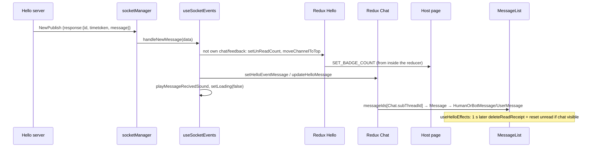

# Flow: receive a message

Hello publishes a `NewPublish` event on a subscribed socket.io channel; `hooks/socketEventHandler.ts:useSocketEvents` turns it into Redux actions, and the message list re-renders from `Chat.messageIds`. History comes over HTTP (`POST /get-history/`) when a channel opens, on socket reconnect and after a call. The socket only receives chat traffic; sending is HTTP (see [send message](send-message.md)).

Event-by-event contract tables and socket lifecycle live in [realtime](../modules/realtime.md#inbound-events-on-the-chat-socket). Slice shapes live in [state](../ui/state.md#slice-shapes). Rendering per message type lives in [message rendering](../modules/message-rendering.md). This page traces the path.



## Steps

1. **Be subscribed** — `hooks/socket.js:useSocket` subscribes the user channel, every channel in the list and the widget event channels; the send path adds new chats. Channel table: [realtime](../modules/realtime.md#channels).
2. **Bind listeners** — `useSocketEvents` (mounted by `components/Chatbot/hooks/useHelloEffects.ts:useHelloEffects`) calls `socketManager.on("NewPublish")` and `on("Typing")`. The effect re-binds on almost every render; see the realtime gotcha before touching its deps.
3. **Normalise** — `handleNewMessage` copies `response.timetoken` onto `message.timetoken`. Message id = `response.id || response.message.id || response.timetoken`.
4. **Own or not** — own = `message.chat_id` set and (`client_sender_id` absent or equal to `k_clientId || a_clientId`). Peer (widget-to-widget) messages carry `chat_id` too, hence the `client_sender_id` check (commit 17706c8).
5. **Unread + order** — `new_event`, `type` `chat` or `feedback`, not own → `Hello/setUnReadCount { resetCount: false }` and `Hello/moveChannelToTop`. `store/hello/helloReducer.ts:setUnReadCount` increments `widget_unread_count` and calls `emitEventToParent('SET_BADGE_COUNT', { badgeCount, channelId })` (capped at `99+`).
6. **Switch on `message.type`:**
   - `chat` with `new_event` → `setChannelClosedStatus { is_closed: false }`, then:
     - `message_type: 'voice_call'` with status `completed` / `no_answer` / `in-progress` → `setHelloEventMessage`, another unread +1, move to top; `completed` on the open channel → `helloVoiceService.emitEvent('call-completed')` (history refetch, step 9). Stops here.
     - not own (bot, agent, peer) → `setLoading(false)`, `playMessageRecivedSound()`, `setHelloEventMessage`, `setTyping { data: false }`.
     - own, tab hidden → `setHelloEventMessage` (a message sent from another tab of the same widget, commit 79db2ff).
     - own, tab visible → `moveChannelToTop`, `updateHelloMessage` (see [Own message echo](#own-message-echo)).
   - `assign` → `changeChannelAssigned` (switches bot/agent; changes whether the thinking dots show).
   - `feedback` with `new_event` → `setHelloEventMessage` (feedback card) and `setChannelClosedStatus { is_closed: true }`.
   - `block` → `setChannelBlockedStatus { is_blocked: !!value }`; the composer is replaced by a notice.
   - `new-channel` → `addChannel` (drops the `id === null` placeholder), `socketManager.subscribe([channel])`, `fetchChannels()`.
   - `update` → rewrites `k_clientId` (or `a_clientId` when there is no `k_clientId`), unsubscribes `channel`, subscribes `ch-comp-<company_id>-<client_id>`.
7. **Store** — `store/chat/chatReducerV2.ts:setHelloEventMessage` converts with `utils/dataConvertWrappers/makeGenericDataFormatUtility.tsx:convertEventMessageToGenericFormat`, prepends the raw message to `rawHelloMsgList[channel]`, prepends the id to `messageIds[channel]` and writes `msgIdAndDataMap[channel][id]`.
8. **Render** — `components/Interface-Chatbot/Messages/MessageList.tsx` reads `messageIds[Chat.subThreadId]` (newest first). `Chat.subThreadId` is copied from `appInfo[tabSessionId].subThreadId` by `components/Chatbot/hooks/useReduxEffects.ts:useReduxEffects`. `Message.tsx` picks `UserMessage`, `HumanOrBotMessage` (role `Human`/`Bot`) or `VoiceCallMessage`; `HumanOrBotMessage` picks `RenderHelloInteractiveMessage`, `RenderHelloAttachmentMessage`, `RenderHelloFeedbackMessage`, etc. by `message_type`. Messages for other channels are stored but not shown until that channel opens.
9. **Mark read** — `useHelloEffects`, debounced 1 s: when the open channel has unread, the chat is open, the tab visible and not minimized (and on small screens the drawer is closed) → `deleteReadReceipt(channel)` and `setUnReadCount { resetCount: true }`. A separate effect posts the total (`widget_unread_count` sum + unread push notifications) as `SET_BADGE_COUNT` with `channelId: '*'`.

`Typing` `{ channel, type: 'chat', action }` → `Chat/setTyping` into `Chat.isTyping[channel]`. No component reads `isTyping` today, so inbound typing has no visible effect; the "thinking" dots are driven by `Chat.loading`.

## Data at key hops

`NewPublish` payload (trimmed; full key list in [realtime](../modules/realtime.md#inbound-events-on-the-chat-socket)):

```json
{ "response": { "id": "6740c1f2a9e3b4d5c6f70812", "timetoken": 1763600001234, "company_id": 12345,
  "message": { "type": "chat", "new_event": true, "channel": "ch-comp-12345.9f1c…",
               "chat_id": 1234, "client_sender_id": "<uuid>", "sender_id": "bot",
               "from_name": "Ava", "is_auto_response": true, "message_type": "interactive",
               "content": { "text": "…", "attachment": [], "interactive": { "…": "…" } } } } }
```

Stored render shape (`msgIdAndDataMap[channel][id]`), from `convertEventMessageToGenericFormat`:

```json
{ "role": "Bot", "from_name": "Ava", "content": "…", "urls": [], "id": "6740…", "message_id": "6740…",
  "show_more": false, "message_type": "interactive", "messageJson": { "…": "interactive or content" },
  "time": 1763600001234, "sender_id": "bot", "is_auto_response": true,
  "replied_msg_content": null, "replied_msg_sender_id": null, "replied_msg_type": null, "replied_from_name": null }
```

Role rule for events: `user` when `sender_id === "user"` or `client_sender_id` matches this client; `Bot` for `sender_id` `bot`/`workflow` or `is_auto_response`; `Human` for any other sender; `user` when there is no sender info. History uses a different rule (own = `chat_id` + matching or absent `client_sender_id`). Keep the two in step when changing either.

## Own message echo

The sender's own message comes back on the socket. With the tab visible it goes to `store/chat/chatReducerV2.ts:updateHelloMessage`, which merges into `msgIdAndDataMap[channel][response.id]` and does **not** touch `messageIds`. So the optimistic bubble is updated in place only if `response.id` equals the optimistic id sent as `widget_msg_id`; otherwise the server copy sits in the map unrendered and the optimistic bubble stays as is until the next history fetch.

> [!WARNING]
> `setHelloEventMessage` never dedupes. If the sending tab becomes hidden before its own echo arrives, the hidden-tab branch prepends the echo again and the bubble shows twice (duplicate React key if the ids match). Any new path that adds socket messages must go through `updateHelloMessage` or check `msgIdAndDataMap` first.

## History fetch

`components/Chatbot/hooks/useHelloIntegration.ts:useFetchHelloPreviousHistory` → `config/helloApi.ts:getHelloChatHistoryApi(channel)` (`POST /get-history/`, `page_size` 30, `start_from: skip + 1`) → `setInitialMessages`, which **replaces** the thread with `convertChatHistoryToGenericFormat(response.data.data)` keyed by `messages[0].channel`. It needs `currentChannelId` and `uuid`. Triggers, all in `useHelloEffects`:

| Trigger | Condition |
|---|---|
| `currentChannelId` changes | not a demo widget; skipped once when `utils/preSubscribedChannels.ts:consumePreSubscribed` returns true |
| `socketManager.onReconnect` | socket.io auto-reconnect only; current channel only (commit 6b18085) |
| `helloVoiceService` `call-completed` | open channel, not demo |

Older pages: `MessageList` infinite scroll → `useGetMoreHelloChats` → `setPaginateMessages` (appends). `hasMoreMessages` = page was full.

**Why the pre-subscribed skip:** a new chat subscribes to its proposed channel before the send, and a bot reply can arrive before `currentChannelId` is set. The fetch that follows would replace the thread and erase that reply (commit 5e53fff). The send path marks the channel only when the server kept the proposed id.

> [!WARNING]
> An empty history response does not clear the thread (no `setInitialMessages` dispatch), and a non-empty one wipes any optimistic or socket message the server does not return yet. Messages missed on channels other than the open one are not refetched after a reconnect; their unread counts come only from the next channel-list fetch.

## Errors

- Socket handler: no try/catch. A `chat` event without `content` throws at the `content: { status }` destructure and the event is lost.
- History: `getHelloChatHistoryApi` toasts and returns `null`; the hook then sets `hasMoreMessages: false`. The existing thread stays.
- `deleteReadReceipt` failures toast; the local unread is already reset.

## Footguns

> [!WARNING]
> A `voice_call` message from someone else adds **two** unread: once in the shared block before the switch and once inside the `voice_call` branch.

- `setLoading(false)` runs for a reply on **any** channel, so a reply elsewhere clears the thinking dots of the open chat.
- The sound plays for every non-own `chat` event, including when the chat is open and focused. It is the only "notification"; campaign pushes come through the separate notification socket ([realtime](../modules/realtime.md#notification-socket)).
- `setUnReadCount` posts to the host page from inside a reducer. Increments are kept out of cross-tab sync (`store/index.js:crossTabSyncConfig`) because every tab's own socket already applies them; resets (`resetCount: true`) are synced, so each tab that replays one posts `SET_BADGE_COUNT` again ([state](../ui/state.md#cross-tab-sync-redux-state-sync)).
- `moveChannelToTop` reads `channelListData.channels` without a guard; an event before the list loads throws.

## Side effects

- Redux `Hello[chatSessionId].channelListData.channels[]`: `widget_unread_count`, order, `is_closed`, `is_blocked`, `assigned_type`, new channels.
- Redux `Chat`: `messageIds`, `msgIdAndDataMap`, `rawHelloMsgList` (the demo widget sends the last 5 back as `conversations`), `isTyping`, `loading`.
- Host page: `SET_BADGE_COUNT` per channel and total.
- HTTP: `DELETE /read-receipt/<channel>`, `POST /get-history/`, `POST /pubnub-channels/list/` on `new-channel`.
- Socket: subscribe on `new-channel`; unsubscribe + subscribe on `update`.
- Storage: `k_clientId` / `a_clientId` rewritten on `update`.
- Audio: `/notification-sound.mp3` at volume 0.2.
