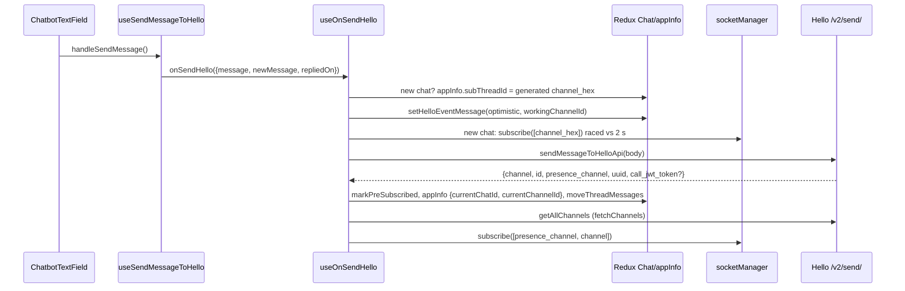

# Flow: send a message

A visitor message (typed text, uploaded attachments, a button click, or a host-page `openWithMessage`) is shown at once as an optimistic bubble, then posted to Hello over HTTP with `POST /v2/send/`. Every send is HTTP. The socket never sends a message; it only delivers the echo and the replies (see [receive message](receive-message.md)).

The REST client and the full send body live in [Hello API](../integrations/hello-api.md#send-body). Socket subscribe details live in [realtime](../modules/realtime.md). This page traces the path.

## Entry points

| Source | Calls | Notes |
|---|---|---|
| Composer send button / Enter | `components/Interface-Chatbot/ChatbotTextField.tsx:handleSendMessage` → `useSendMessageToHello` | Enter without Shift; blocked while `buttonDisabled` or the peer channel `is_blocked` |
| Interactive buttons, list rows, carousel, Apple cards | `components/Hello/RenderHelloInteractiveMessage.tsx` → `useSendMessageToHello` with `replied_msg_type: interactive` | sends the button `title` (see warning below) |
| Starter question picked on the host page | `hooks/HELLO/eventHandlers/embeddingScript/embeddingScriptEventHandler.ts:handleStarterQuestionOptionClicked` → `useSendMessageToHello` | event `STARTER_QUESTION_OPTION_CLICKED` |
| `window.chatWidget.openWithMessage(message, autoSend, alwaysNewChat)` | `public/chat-widget.js` posts `SEND_INITIAL_MESSAGE` → `handleSendInitialMessage` → `onSendHello({ forceNewChat: true })` | skips `useSendMessageToHello`; see [Host page: openWithMessage](#host-page-openwithmessage) |
| Call button | `components/Interface-Chatbot/CallButton.tsx`, `components/Interface-Chatbot/ChatbotDrawer.tsx` → `useOnSendHello({ voiceCall: true })` | reads `call_jwt_token`; see [voice calling](../modules/voice-calling.md) |
| Feedback card | `components/Hello/RenderHelloFeedbackMessage.tsx` → `config/helloApi.ts:submitFeedback` | separate endpoint, no optimistic message; see [Feedback](#feedback) |

`components/Chatbot/hooks/useChatActions.ts` is not a send hook. It only wraps `setLoading`, `setChatsLoading`, `setImages`, `setNewMessage` and `setToggleDrawer` dispatches.



## Steps

1. **Read the input** — `components/Interface-Chatbot/ChatbotTextField.tsx:handleSendMessage`
   Clears local `inputValue` and `draftData.prefillInputMessage`, calls `sendMessageToHello()`, emits `not-typing` (`hooks/socketEventEmitter.ts:useTypingStatus`), then `clearReply()`. The reply id passed in is `replyToMessage.message_id || replyToMessage.id`.
2. **Build the optimistic message** — `components/Chatbot/hooks/useHelloIntegration.ts:useSendMessageToHello`
   Text = `messageRef.current.value || message`. Returns `false` when text is blank and `Chat.images` is empty. Builds `newMessage` with a 24-char ObjectId from `utils/utilities.js:generateNewId`, calls `onSendHello` (not awaited), sets `Chat.newMessage` (scrolls the list down), clears the input.
3. **Pick ids** — `components/Chatbot/hooks/useHelloIntegration.ts:useOnSendHello`
   Returns early for blank text with no images (unless `voiceCall`). Channel = `overrideChannelId` arg, else `appInfo.overrideChannelId`, else `currentChannelId`; chat and team likewise. `forceNewChat` blanks all three.
4. **New chat only: propose a channel** — if there is no chat id and no channel id, `utils/utilities.js:generateChannelId` gives `ch-comp-<companyId>.<uuid>`. A `notification-…` thread is moved into it (`moveThreadMessages`), and `appInfo.subThreadId` is set to it so the bubble renders there.
5. **Optimistic insert** — `addHelloMessage(messageWithReply, workingChannelId)` → `store/chat/chatReducerV2.ts:setHelloEventMessage`. Reply fields (`replied_msg_content`, `replied_msg_type`, `replied_msg_sender_id`, `replied_from_name`) come from `ReplyContext` and are local only; the server gets just `replied_on`.
6. **Build `channelDetail`** — only when there is no chat id or the widget is a demo. Customer fields come from `Hello[chatSessionId].clientInfo`; `channel_hex` = the proposed id.
7. **UI flags** (not for voice calls) — new chat with `showWidgetForm` → `setOpenHelloForm(true)`; pending images are taken and `Chat.images` cleared; bot or unassigned channel → `setLoading(true)` (thinking dots, send disabled); `useHelloTimeout` starts a 10 s timer that clears `loading`.
8. **Pre-subscribe** (new chat only) — `socketManager.subscribe([channel_hex])` raced against `PRE_SUBSCRIBE_TIMEOUT_MS` (2000). Demo widget on an existing channel awaits `subscribe([channel])` without a timeout.
9. **POST** — `config/helloApi.ts:sendMessageToHelloApi`. `message_type` is `text`, `voice_call`, `attachment` (no text) or `text-attachment`. `widget_msg_id` = the optimistic id. When `channelDetail` was sent and the response has `uuid`, it writes `k_clientId` (this is the `a_clientId` → `k_clientId` promotion; `a_clientId` is not removed).
10. **Branch on the result** — see [Response handling](#response-handling) and [Errors](#errors).

## Data at key hops

Optimistic message as dispatched (step 5), and as stored after `convertEventMessageToGenericFormat`:

```json
{ "id": "6740c1f2a9e3b4d5c6f70812", "role": "user", "chat_id": 1234,
  "content": { "text": "Hi", "attachment": [] }, "timetoken": 1763600000000, "sender_id": "user",
  "replied_msg_content": { "text": "…", "attachment": [] }, "replied_msg_type": null,
  "replied_msg_sender_id": "bot", "replied_from_name": "Ava" }

{ "role": "user", "id": "6740c1f2a9e3b4d5c6f70812", "message_id": "6740c1f2a9e3b4d5c6f70812",
  "content": "Hi", "urls": [], "messageJson": { "text": "Hi", "attachment": [] },
  "time": 1763600000000, "sender_id": "user", "replied_msg_content": { "…": "…" } }
```

`POST /v2/send/` for a first message (full schema: [Hello API](../integrations/hello-api.md#send-body)):

```json
{ "type": "widget", "widget_msg_id": "6740c1f2a9e3b4d5c6f70812", "message_type": "text",
  "content": { "text": "Hi", "attachment": [] }, "chat_id": null,
  "channelDetail": { "uuid": "…", "unique_id": "…", "presence_channel": "…", "team_id": null,
                     "customer_name": null, "pseudo_name": null, "new": true,
                     "channel_hex": "ch-comp-12345.9f1c…" },
  "replied_on": "<message id>", "user_data": {}, "sessionVariables": {} }
```

Response fields the widget reads (`response.data.data`):

```json
{ "channel": "ch-comp-12345.9f1c…", "id": 1234, "presence_channel": "…", "uuid": "<client uuid>",
  "call_jwt_token": "<voice calls only>", "session_id": "<demo widget only>" }
```

## Response handling

Runs only when `data` is truthy **and** (no chat id, or no channel id, or demo widget). For an ordinary send on an existing chat the response is ignored; the socket echo reconciles the bubble (see [receive message](receive-message.md#own-message-echo)).

1. If pre-subscribed and `data.channel === channel_hex`: `utils/preSubscribedChannels.ts:markPreSubscribed`. It runs before the next dispatch, because that dispatch triggers the history effect, which must skip one fetch.
2. `setDataInAppInfoReducer({ subThreadId: channel, currentChatId: id, currentChannelId: channel, overrideChannelId: "" })`, plus `demoSessionId` from `utils/utilities.js:extractSessionId` for demo widgets.
3. If the server returned another channel id: `moveThreadMessages({ from: channel_hex, to: channel })` and unsubscribe the proposed id.
4. Not demo: `useFetchChannels` refetches the list; one real channel → `emitEventToParent('HIDE_STARTER_QUESTION')`.
5. Subscribe `[presence_channel, channel]` (demo: `[channel]`); a subscribe error is logged only.
6. Return `data`. Voice callers pass `data.call_jwt_token` to `helloVoiceService.initiateCall`.

Message id reconciliation: the optimistic id is sent as `widget_msg_id`. Nothing in the send path swaps ids; the echo handler merges by `response.id`.

> [!TODO] Needs a human: does Hello always use `widget_msg_id` as the echoed message `id`? `updateHelloMessage` only replaces the optimistic bubble when the two ids match (commit 1e116a1, "message_id creation from widget", switched to a 24-char ObjectId, which suggests yes).

## Errors

- `config/helloApi.ts:sendMessageToHelloApi` catches every HTTP error, shows `errorToast(error.message)` (axios text such as "Request failed with status code 500", not the server message) and returns `null`. The `catch` in `useOnSendHello` only sees thrown exceptions, not HTTP failures.
- On `null`: the pre-subscription is dropped; nothing else runs.

> [!WARNING]
> A failed send leaves the optimistic bubble in place with no failed state and no retry. In a bot channel `Chat.loading` stays `true` (thinking dots, send button disabled) until the 10 s `useHelloTimeout` fires. A failed **first** message is worse: `currentChannelId` is never set, so the next send proposes a new channel id and switches `subThreadId`, and the failed bubble disappears from view (it stays in Redux under the old id).

- Upload failure shows two toasts: `uploadAttachmentToHello` toasts `error.message`, then `handleImageUpload` toasts "Failed to upload images". More than 4 files (`MAX_IMAGES`) is rejected before upload.

## Attachments

`components/Interface-Chatbot/ChatbotTextField.tsx:handleImageUpload` uploads each file with `uploadAttachmentToHello(file, widgetInfo.inbox_id)` (`POST /v2/upload/?type=chat&inbox_id=…`, multipart field `attachment`) and appends `response.data[0]` to `Chat.images`. Previews read `image.path`. The paperclip is hidden until a `subThreadId` exists. On send, `useOnSendHello` moves `Chat.images` into the body's `content.attachment` and clears it. The optimistic message also carries `images` as `content.attachment`.

## Host page: openWithMessage

`public/chat-widget.js` `openWithMessage(message = "", autoSend = true, alwaysNewChat = true)` opens the widget and posts `SEND_INITIAL_MESSAGE`. The iframe side is described in [app shell](../modules/app-shell.md#initial-message-send_initial_message). In short:

1. `alwaysNewChat: false` waits for the channel list; if any channel has an `id`, the message is dropped (not prefilled, not sent).
2. Otherwise the drawer closes and `appInfo` ids are blanked.
3. `autoSend: false` → `draftData.prefillInputMessage`, which `ChatbotTextField` puts into the input. The user sends it normally.
4. `autoSend: true` → waits for `widgetInfo.company_id`, then `onSendHello({ message, newMessage: buildInitialNewMessage(message), forceNewChat: true })`, which always takes the new-chat path above.

## Footguns

> [!WARNING]
> `useSendMessageToHello` reads the composer's `messageRef` from `MessageContext` first and only falls back to its `message` argument. An interactive button clicked while the visitor has text in the composer sends the **typed text**, not the button title, and clears the composer. The starter-question path is not affected: it runs in `ChatbotWrapper`, outside the `MessageContext` provider in `components/Chatbot/Chatbot.tsx`.

> [!WARNING]
> `onSendHello` from `useSendMessageToHello` is not awaited and its result is dropped. Code that needs the response (voice calls) must call `useOnSendHello` directly.

- Pending `Chat.images` are attached to **any** send, including a button click or an `openWithMessage` auto-send.
- `channelDetail` is resent on every demo-widget message, so `k_clientId` is rewritten on each one.

## Feedback

`components/Hello/RenderHelloFeedbackMessage.tsx` calls `config/helloApi.ts:submitFeedback` (`POST /receive-feedback/` with `feedback_msg`, `rating`, `token`, `type: "post-feedback"`, `id`) and then `updateHelloMessage` with the rating so it survives a remount. `submitFeedback` returns `null` on error instead of throwing, so the card shows "submitted" even when the request failed; the next history fetch shows the truth.

## Side effects

- Redux: `Chat` (optimistic insert, `images`, `loading`, `openHelloForm`, `newMessage`, thread moves), `appInfo[tabSessionId]` (`subThreadId`, `currentChatId`, `currentChannelId`, `overrideChannelId`, `demoSessionId`), `Hello` (channel list refetch).
- Storage: `k_clientId` (prefixed) after a send with `channelDetail`; `setLocalStorage` also posts `setDataInLocal` with key `hello-widget-uuid` to the host.
- Socket: subscribe of `channel_hex`, then `channel` + `presence_channel`; unsubscribe of an unused proposal; `not-typing` emit.
- Host page: `HIDE_STARTER_QUESTION` after the first real channel exists.
