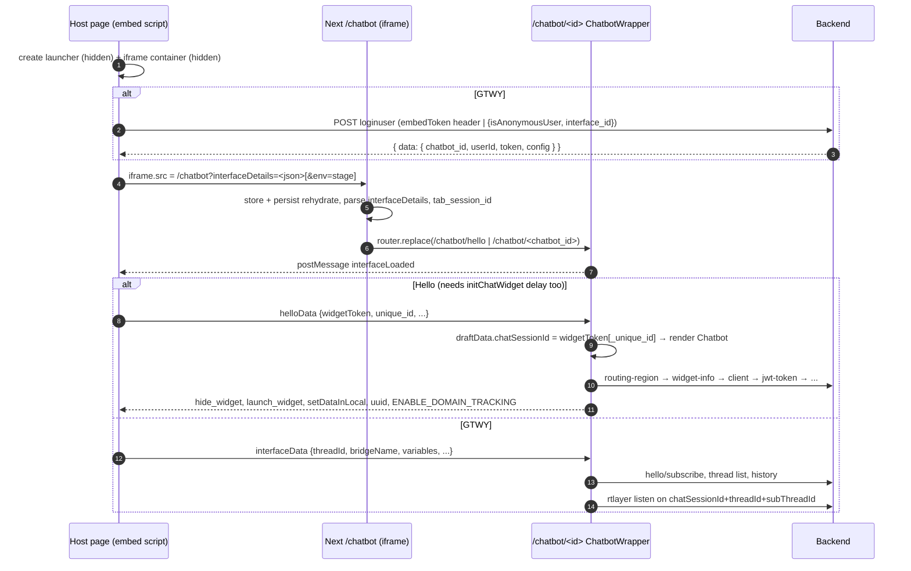

# Flow: widget boot

A host page loads one embed script; the script builds a launcher and an iframe at `<origin>/chatbot?interfaceDetails=…`; the Next app inside boots, posts `interfaceLoaded`, and the host answers with its config (`helloData` for MSG91 Hello, `interfaceData` for GTWY). The iframe then starts the backend session: Hello client + socket, or GTWY threads + history + rtlayer.

This doc is the hop list. Details live in: [embed-scripts](../modules/embed-scripts.md) (host API, message tables, env variants), [app-shell](../modules/app-shell.md) (routes, store, session keys), [hello](../integrations/hello.md) (Hello boot steps and endpoints), [ai-chat](../modules/ai-chat.md) (GTWY threads/history). Full endpoint and postMessage tables: [api](../api.md).

## Sequence



## Steps

### Shared start (both products)

1. **Host script runs** — `public/chat-widget.js:HelloChatbotEmbedManager` (Hello) or `public/chatbot.js:ChatbotEmbedManager` (GTWY).
   Hello: `loadContent` appends the launcher (hidden), the stylesheet and a hidden iframe container, then `processChatbotDetails` sets `iframe.src`. GTWY: `loadChatbotEmbed` → `fetchChatbotDetails` → `processChatbotDetails(response)` (step G1). Host sees: nothing yet (launcher `display: none`).
2. **Iframe URL**
   ```text
   Hello: <scriptOrigin>/chatbot?interfaceDetails=%7B%22isHelloUser%22%3Atrue%7D   (+ &env=stage from -dev/-local only)
   GTWY : <urls.chatbotUrl>?interfaceDetails=<encodeURIComponent(JSON.stringify(response.data))>
   ```
3. **Root layout + store** — `app/layout.tsx` → `components/AppWrapper.tsx`. Importing `store/index.js` builds the store (`initializeStore`) and `persistor`; `PersistGate` renders nothing until `persist:root` (localStorage) and `persist:appInfo` (sessionStorage) rehydrate. Client-only: `createStateSyncMiddleware` + `initMessageListener` on BroadcastChannel `crossTabChannel`. Theme starts from sessionStorage `helloConfig.primary_color`, else `#333333`.
4. **Parse the URL** — `app/chatbot/layout.tsx:ChatbotLayout` (wrapped by `addUrlDataHoc`). `useMemo([])` parses `interfaceDetails` into `{ chatbot_id, userId, token, config, isHelloUser }`; missing/`"undefined"`/bad JSON → all `null`, `isHelloUser: false`. `env` is kept only if it equals `stage`. Provides `ChatbotContext`. Because this layout also wraps `/chatbot/[chatbotId]`, it stays mounted across the redirect in step 6 and keeps the values parsed from the first URL.
5. **Tab id** — `app/chatbot/page.tsx:InterfaceEmbed` reads or creates sessionStorage `tab_session_id` (`Date.now()`) and dispatches `setDataInDraftReducer({ tabSessionId })`.
6. **Verify and redirect** — same component.
   - `token` present (GTWY) → `SetSessionStorage("interfaceToken", token)`, `SetSessionStorage("interfaceUserId", userId)`, `isHelloUser: false`, VERIFIED → `setDataInDraftReducer({ chatbotId, chatSessionId: chatbot_id })` → `router.replace('/chatbot/<chatbot_id>')`.
   - `isHelloUser` → VERIFIED → `router.replace('/chatbot/hello')`, or `/chatbot/hello?env=stage` when `environment` is set.
   - Neither → spinner forever (`NOT_VERIFIED` is never set). The host sees no launcher because `interfaceLoaded` is never posted.
7. **Mount the widget** — `app/chatbot/[chatbotId]/page.tsx` renders `components/Chatbot-Wrapper/ChatbotWrapper.tsx`. `ChatbotWithHooks` registers the message handlers (`useEmbeddingScriptEventHandler`) and the localStorage listener, but renders `null` until `draftData.chatSessionId` is set (GTWY: already set in step 6; Hello: set by `helloData`).
8. **Handshake** — `ChatbotWrapper` posts `{ type: "interfaceLoaded" }` to `window.parent` inside `setTimeout(0)`, after the child effects registered the listeners, so the reply cannot arrive before a handler exists.

### Hello branch

H1. **Host waits for two flags** — `public/chat-widget.js:showIconIfReady` runs on `interfaceLoaded` and after the `initChatWidget(data, delay)` timer (`subdomainInitFunction`). Only when both `state.interfaceLoaded` and `state.delayElapsed` are true:
   - launcher shown if `helloProps.hide_launcher` is `false`/`'false'` (and not `isMobileSDK`); auto-open if `launch_widget`;
   - `sendInitialData` posts `helloData` with the whole `helloProps`, then `CHATBOT_OPEN` if the container is already visible.
   Event-source check: the host only accepts messages whose `event.source` is its own iframe.

H2. **`helloData` handler** — `hooks/HELLO/eventHandlers/embeddingScript/embeddingScriptEventHandler.ts:handleHelloData`:
   ```ts
   // event.data.data (host initChatWidget payload; full key list in embed-scripts.md)
   { widgetToken, unique_id?, mail?, number?, name?, user_jwt_token?, sdkConfig?, theme?, variables?, hideFullScreenButton?, ... }
   ```
   1. `fullWidgetToken = unique_id ? widgetToken + "_" + unique_id : widgetToken`; `SetSessionStorage('widgetToken', fullWidgetToken)` (also backed up to localStorage, see "Storage blocked").
   2. `removeFromLocalStorage('is_anon')`; theme (`sdkConfig.customTheme`, `theme`/`sdkConfig.theme`); `variables` → `setVariablesForHelloBot`.
   3. Token changed vs the previous sessionStorage value → reset `appInfo` ids (`subThreadId`, `currentChannelId`, `currentChatId`, `currentTeamId`, `demoSessionId`) and load notifications from localStorage `<fullWidgetToken>_persist:Chat`.
   4. `setLocalStorage('userData', {unique_id, mail, number, user_jwt_token (only if identified), name})`, `setLocalStorage('WidgetId', widgetToken)` — both stored under the `<fullWidgetToken>_` prefix.
   5. `setDataInDraftReducer({ chatSessionId: fullWidgetToken, widgetToken: fullWidgetToken, isHelloUser: true })` — this is what makes `ChatbotWithHooks` render `Chatbot`. Reset appInfo ids again under the new key.
   6. sessionStorage `helloConfig` = the raw payload; `setHelloConfig`; `showWidgetForm: false` when `mail && number && name`.

H3. **Hello services** — `components/Chatbot/Chatbot.tsx` mounts `useChatEffects`, `useHelloEffects`, `useReduxEffects`, `useRtlayerEventManager`. `components/Chatbot/hooks/useHelloEffects.ts` runs `initializeHelloServices(chatSessionId.split('_')[0])` when `draftData.chatSessionId` changes; it returns early unless that equals localStorage `WidgetId`. Order (details and response keys in [hello](../integrations/hello.md#boot-sequence)):
   1. `getRoutingRegion()` → `setRegionUrls(region_url, socket_url)`; socket reconnects if they changed.
   2. `initializeHelloChat()` (widget-info) → `setWidgetInfo`; host gets `hide_widget`, `setDataInLocal {key: 'widgetInfo'}`, maybe `launch_widget`; `null` → `initializeHelloChat_failed` (host sets `block_chatbot` and removes the widget DOM).
   3. Client: `registerAnonymousUser()` when there is no `a_clientId`/`k_clientId`/`unique_id`/`mail`/`number`, else `fetchChannels()` (channel list resolves the uuid). Host gets `uuid` (co-browse) and `setDataInLocal` for `hello-widget-uuid` / `hello-widget-anonymoud-uuid`.
   4. `getJwtToken()` → `setJwtToken` → `hooks/socket.js:useSocket` connects socket.io to `getSocketUrl()`.
   5. Greeting (`lex`/`chatgpt` bots) → `SHOW_STARTER_QUESTION` to the host if there is no real channel; `getAgentTeamApi`; voice-call client token if `voice_call_widget`; `saveClientDetails` for extra host keys; finally `ENABLE_DOMAIN_TRACKING` to the host.

H4. **Host reacts** — `public/chat-widget.js:handleIncomingMessages`: `hide_widget`/`launch_widget` are ignored when the host passed `hide_launcher`/`launch_widget` itself; `SET_BADGE_COUNT` updates the badge; `ENABLE_DOMAIN_TRACKING` patches host `history` and reports routes back as `parent-route-changed`.

### GTWY branch

G1. **Login before the iframe** — `public/chatbot.js:fetchChatbotDetails`: `POST <urls.login>` with header `Authorization: <embedToken>` when the `<script id="chatbot-main-script">` has `embedToken`, else body `{ isAnonymousUser: true, interface_id }`. `processChatbotDetails(response)` puts `response.data` in the iframe URL and merges `response.data.config` into the size config.
   ```ts
   // interfaceDetails for GTWY (keys read by app/chatbot/layout.tsx)
   { chatbot_id: string, userId: string, token: string, config?: { themeColor?, hideCloseButton?, ... } }
   ```
G2. **Identity into appInfo** — `app/chatbot/layout.tsx` dispatches `setDataInAppInfoReducer({ chatBotId, userId, config })` once `chatSessionId` exists, and `onConfigChange(config)` sets the theme color (`config.themeColor`, default `#000000`).
G3. **Host sends props** — on `interfaceLoaded`, `public/chatbot.js:sendInitialData` shows the launcher unless `hideIcon`, posts `interfaceData` with `state.tempDataToSend` (script attributes plus anything passed to `SendDataToChatbot` earlier), clears it, and opens if `defaultOpen`. If `tempDataToSend` is `null`, nothing is posted.
G4. **`interfaceData` handler** — `hooks/GTWY/eventHandlers/embeddingScript/embeddingScriptEventHandler.ts:useHandleGtwyEmbeddingScriptEvents` (`handleInterfaceData`):
   ```ts
   // event.data.data (InterfaceData in that file)
   { threadId?, bridgeName?, helloId?, version_id?, variables?, headerButtons?, eventsToSubscribe?, modalConfig?,
     allowModalSwitch?, chatTitle?, chatSubTitle?, chatIcon?, allowBridgeSwitch?, hideCloseButton?, hideFullScreenButton?,
     modelChanged?, serviceChanged? }
   ```
   `threadId` → `appInfo.threadId` (and `subThreadId: ''` when it differs from the current one); `bridgeName` + `variables` → `appInfo.bridgeName` and `addDefaultContext`; `version_id` → `appInfo.versionId`; UI keys → `Interface` slice; `eventsToSubscribe` filtered by `ALLOWED_EVENTS_TO_SUBSCRIBE`.
G5. **Chat state** — `components/Chatbot/hooks/useReduxEffects.ts` mirrors ids into `Chat` (bridge defaults to `root`). `components/Chatbot/hooks/useChatEffects.ts`: `getHelloDetailsStart({ slugName, versionId })` (saga → `getHelloDetailsApi`), `useFetchAllThreads` when `threadId && bridgeName` (→ `setThreads`, whose `appInfo` extra-reducer picks `subThreadId`), and `useGetInitialChatHistory` on any id change. See [ai-chat](../modules/ai-chat.md#threads-and-sub-threads).
G6. **Realtime** — `components/Chatbot/hooks/useRtlayerEventManager.tsx` opens the rtlayer client (non-Hello only) and listens on `chatSessionId + (threadId || userId) + (subThreadId || userId)`. `useHelloEffects` also runs for GTWY but `initializeHelloServices` returns at the `WidgetId` guard.

### `?env=stage`

| Where | Effect |
|---|---|
| Host page URL `?env=stage` | Only `public/chat-widget-dev.js` and `public/chat-widget-local.js` append `&env=stage` to the iframe URL. The prod Hello script and all GTWY scripts never do. |
| `app/chatbot/layout.tsx` | `environment = 'stage'` in `ChatbotContext`; any other value → `null`. |
| `app/chatbot/page.tsx` | Forwards it: `/chatbot/hello?env=stage`. |
| `config/regionConfig.ts` | Read from `window.location.search` once at module load: default Hello REST and socket hosts become the stage hosts instead of `NEXT_PUBLIC_MSG91_HOST_URL` / `NEXT_PUBLIC_SOCKET_URL`. A routing-region response still overrides both. |
| `components/Chatbot/hooks/HelloVoiceService.ts`, `hooks/notifications/notificationSocketManager.ts` | Read `env` themselves (WebRTC environment, notification socket). See [hello](../integrations/hello.md). |

## What the host sees, step by step

| Moment | Hello host | GTWY host |
|---|---|---|
| Script loaded | Hidden launcher + hidden container; iframe loading | Login request in flight; iframe `src` set after it returns |
| `interfaceLoaded` only | Nothing until `initChatWidget` delay also elapsed | Launcher shown (unless `hideIcon`), `interfaceData` sent |
| After `helloData` | Launcher per `hide_launcher`; `CHATBOT_OPEN` if already open | — |
| widget-info done | `hide_widget` / `launch_widget` may hide/show/open; `setDataInLocal` writes host localStorage `widgetInfo` | — |
| Client resolved | `uuid` (CobrowseIO starts), `setDataInLocal` for client uuids | — |
| End of boot | `SHOW_STARTER_QUESTION` bubble (maybe), `SET_BADGE_COUNT`, `ENABLE_DOMAIN_TRACKING` | Threads/history are internal; host sees nothing |
| widget-info failed | `initializeHelloChat_failed` → widget removed, `initChatWidget` blocked | — |

## Data at key hops

```ts
// draftData after boot (store/draftData/draftDataSlice.ts)
Hello: { tabSessionId: "1697…", chatSessionId: "<widgetToken>[_<unique_id>]", widgetToken: same, isHelloUser: true }
GTWY : { tabSessionId: "1697…", chatbotId: "<chatbot_id>", chatSessionId: "<chatbot_id>", isHelloUser: false }

// appInfo key = `${chatSessionId}_${tabSessionId}` (sessionStorage persist:appInfo)
GTWY : { chatBotId, userId, config, threadId, subThreadId, bridgeName, versionId, helloId?, hideCloseButton?, ... }
Hello: { subThreadId, currentChannelId, currentChatId, currentTeamId, isChatbotOpen, callToken?, ... }
```

Storage written during boot (iframe origin unless noted):

| Key | Storage | Written by |
|---|---|---|
| `tab_session_id` | session | `app/chatbot/page.tsx` |
| `interfaceToken`, `interfaceUserId` | session | `app/chatbot/page.tsx` (GTWY) |
| `widgetToken`, `helloConfig` | session | `handleHelloData` (Hello) |
| `<fullWidgetToken>_WidgetId`, `<fullWidgetToken>_userData`, `<fullWidgetToken>_a_clientId` / `_k_clientId` | local | `handleHelloData`, `helloApi.ts` via `setLocalStorage` |
| `persist:root` (Interface, Hello), `persist:appInfo`, `<widgetToken>_persist:Chat` | local / session / local | redux-persist (`store/combineReducer.js`) |
| `hello-widget-uuid`, `hello-widget-anonymoud-uuid`, `widgetInfo` | **host** local | host script on `setDataInLocal` |

## Errors

- GTWY login fails → `fetchChatbotDetails` logs and returns `undefined`; `processChatbotDetails(undefined)` throws, caught in `loadChatbotEmbed`. No iframe `src`, no launcher. Nothing is shown to the user.
- Bad or missing `interfaceDetails` → defaults; `/chatbot` spins forever (step 6).
- `/routing-region/` fails → env defaults; boot continues. `/widget-info/` returns `null` → `initializeHelloChat_failed`, no JWT, no socket. Every other Hello call: toast + `null`/`[]` ([hello](../integrations/hello.md#when-it-fails)).
- Any exception inside `initializeHelloServices` is caught and logged; later steps are skipped.
- GTWY history/thread calls: see [ai-chat](../modules/ai-chat.md). A 401 from any GTWY call runs `localStorage.clear()` and navigates the iframe to `/?error=session expired` (`utils/interceptor.ts`).

### Storage blocked

- `utils/ChatbotUtility.ts:SetSessionStorage` / `GetSessionStorageData` catch storage errors. `widgetToken` (the only key in `SESSION_KEYS_BACKED_BY_LOCAL`) is mirrored to localStorage and restored from it when sessionStorage was emptied by an iframe reload (iOS in-app browsers).
- redux-persist storages are built with `createWebStorage` (`utils/storageUtility.ts`); on the server they are `createNoopStorage()`.
- A broader in-memory fallback for every read and write (PR #472, 47d5e4a) was reverted the same day (542cc80); the narrow `widgetToken` backup (69e0bc5) shipped instead. See [app-shell](../modules/app-shell.md#storage-and-storage-blocked).

> [!WARNING]
> `utils/utilities.js:setLocalStorage`, `getLocalStorage` and `removeFromLocalStorage` have no try/catch. If the browser throws on `localStorage` access (storage fully blocked for third-party iframes), `handleHelloData` throws at `removeFromLocalStorage('is_anon')`, before it dispatches `chatSessionId`. `Chatbot` never renders, yet the host already showed the launcher. `utils/interceptor.ts` also reads `sessionStorage.getItem` directly, so every GTWY call fails in the same situation.

> [!TODO] Needs a human: is a fully blocked localStorage (not just a reset sessionStorage) a supported case? If yes, the Hello boot path needs the reverted fallback or try/catch in `utils/utilities.js`.

## Side effects

- postMessages iframe → host: `interfaceLoaded`; Hello also `hide_widget`, `launch_widget`, `setDataInLocal`, `uuid`, `SHOW_STARTER_QUESTION`, `SET_BADGE_COUNT`, `ENABLE_DOMAIN_TRACKING`, `initializeHelloChat_failed`, `OPEN_CHATBOT` (call rejoin).
- postMessages host → iframe: `helloData`, `CHATBOT_OPEN`, `SET_VARIABLES_FOR_BOT` (Hello); `interfaceData` (GTWY).
- Network: GTWY `loginuser` from the host page; Hello REST chain from the iframe; socket.io (Hello) or rtlayer (GTWY); BroadcastChannel `crossTabChannel` between tabs of the iframe origin.
- Custom window event `localstorage-updated` on client-id writes (picked up by `hooks/HELLO/eventHandlers/localStorage/localStorageEventsHandler.ts`).

## Gotchas

> [!WARNING]
> Hello never boots if the host does not call `initChatWidget`: `helloProps` stays `null`, `sendInitialData` sends nothing, and the iframe sits with `chatSessionId` empty. See [embed-scripts](../modules/embed-scripts.md#gotchas).

> [!WARNING]
> Handlers in the embedding-script registry are registered once (`useEffect(…, [])`) and keep first-render closures. In the GTWY handler `currentThreadId` is therefore the value at mount (usually `undefined`), so every `interfaceData` that carries `threadId` also resets `subThreadId` to `''`, even when the thread did not change. The Hello handler works around this with refs (`channelListRef`, `companyIdRef`, `onSendHelloRef`); use refs for any state a new handler reads.

> [!WARNING]
> `interfaceDetails` and `env` are parsed once per layout mount and `config/regionConfig.ts` reads `env` at module load. A new token or env needs a new iframe `src`, not a `postMessage`.

> [!WARNING]
> Do not post `interfaceLoaded` from anywhere else or earlier. The host treats it as "listeners are ready" and immediately sends `helloData`/`interfaceData`; a message that arrives before `useEmbeddingScriptEventHandler` attached is lost and is not re-sent.

## Changing it safely

- New boot-time host key: add it in all three script variants ([embed-scripts](../modules/embed-scripts.md#changing-it-safely)), read it in `handleHelloData` or `handleInterfaceData`, and for Hello add it to `keysToRemove` in `useHelloEffects.ts` if it must not reach `saveClientDetails`.
- New Hello boot call: insert it in `initializeHelloServices` after `getRoutingRegion()`; every Hello host is region-locked.
- Test both branches from a static host page: Hello with `public/chat-widget-local.js` + `initChatWidget({ widgetToken })` (try with and without `?env=stage`, and with a `delay`); GTWY with a `<script id="chatbot-main-script">` that has `embedToken` or `interface_id`. Watch the postMessage order in devtools: `interfaceLoaded` → `helloData`/`interfaceData` → Hello status messages.
